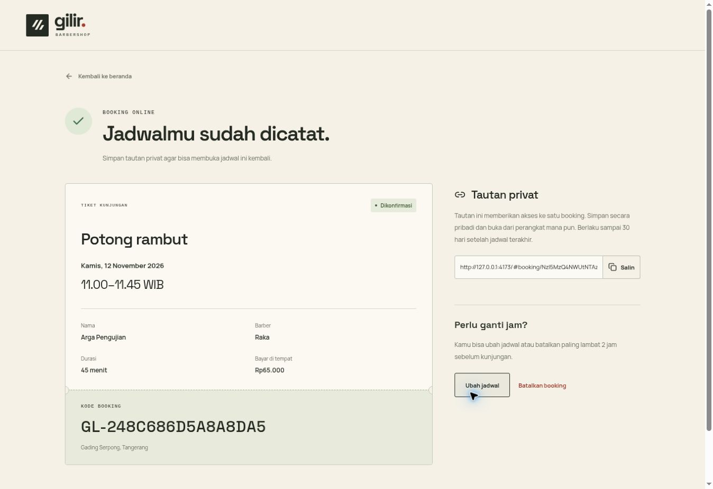

# Catatan validasi versi awal

Diperiksa pada 11 November 2026. Ini adalah hasil yang benar-benar dijalankan di lingkungan pengembangan, bukan klaim bahwa deployment produksi sudah selesai.

| Pemeriksaan | Hasil |
| --- | --- |
| TypeScript dan Vite production build | Lolos |
| `go vet ./...` | Lolos |
| `go test -race -count=1 -v ./...` dengan PostgreSQL 17.7 | Lolos |
| Dua pembuatan booking pada slot yang sama secara bersamaan | Satu berhasil, satu ditolak |
| Exclusion constraint database tanpa pemeriksaan aplikasi | Menolak benturan rentang |
| Pengiriman ulang dengan requestKey sama | ID, kode, dan token booking tetap sama |
| requestKey sama dengan isian berbeda | Ditolak |
| Rentang bersebelahan dan kalender barber berbeda | Diterima sesuai jadwal |
| Reschedule bentrok | Jadwal dan version lama tetap berlaku |
| Perubahan harga atau durasi setelah konfirmasi | Snapshot booking lama tetap berlaku |
| Penawaran baru dengan version layanan lama | Ditolak untuk ditinjau ulang |
| Izin barber mengganggu booking mendatang | Ditolak dengan kode booking terdampak |
| Agenda dan detail milik barber lain | Tidak dikirim ke akun Barber |
| Penulisan tanpa CSRF dan Origin yang tidak diizinkan | Ditolak |
| Sesi akun Barber yang dinonaktifkan | Ditolak pada permintaan berikutnya |
| Perubahan status terlalu cepat atau memakai version lama | Ditolak |
| Batas dua jam perubahan pelanggan | Diuji pada batas tepat dan satu detik setelahnya |
| Walk-in pada menit berjalan | Diterima dan berbagi kalender dengan online |
| Tautan privat lintas instance aplikasi dan batas kedaluwarsa | Diuji melalui API |
| Browser desktop, booking online sampai tiket privat | Lolos pada PostgreSQL dan Go yang berjalan |
| Browser desktop, perubahan jam dari tiket pelanggan | Lolos, detail menampilkan waktu baru |
| Browser desktop, formulir login staf | Tampil tanpa akun contoh atau pemilih peran |
| CLI pembuatan Admin secara interaktif | Lolos, kata sandi tidak tampil |
| Akun database runtime tidak dapat membuat tabel | Diuji pada PostgreSQL |
| HTTP server Go menyajikan root, `/admin`, halaman staf, dan gambar | Lolos |
| Login HTTP memakai akun yang dibuat dari CLI | Lolos |
| Dump dan restore ke database terpisah | Diuji |

Tes unit juga mencakup istirahat, batas jam kerja, libur mingguan, tanggal tidak valid, jendela 30 hari, waktu server sampai detik, token yang diubah, dan verifikasi kata sandi.

## Batas verifikasi

Docker Engine tidak tersedia di lingkungan pengerjaan. Image Docker dan perintah Compose belum dieksekusi. Build frontend, binary Go, migrasi, akun database terbatas, API, dan pengujian integrasi dijalankan secara langsung. Berkas Compose diperiksa sebagai YAML.

Skrip PowerShell belum dieksekusi di Windows. Alur staf setelah login belum diperiksa melalui browser, sedangkan autentikasi, cakupan data, dan operasinya diuji melalui HTTP. Tata letak mobile mengikuti CSS responsif rancangan awal, tetapi pengujian perangkat fisik belum dilakukan pada versi backend ini.

Deployment domain publik, koneksi HTTPS produksi, pengujian beban, peninjauan keamanan independen, dan uji penerimaan bersama pemilik belum dilakukan. Sebelum dipakai pelanggan sebenarnya, jalankan Compose di laptop dan lakukan uji operasional sesuai README.

## Bukti tampilan

Booking contoh berikut dibuat melalui browser, kemudian jadwalnya diubah dari pukul 10.00 ke 11.00 WIB. Nama dan nomor yang digunakan adalah data pengujian lokal.

